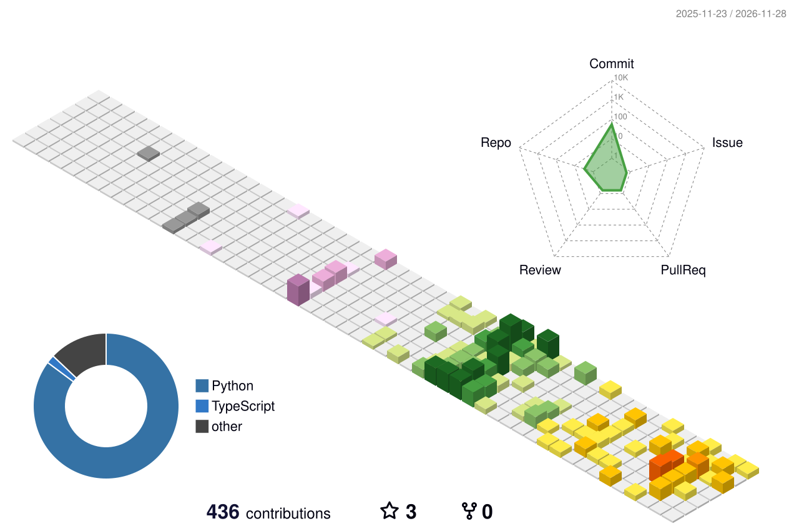

<!-- Header -->

  

  
  
  
  

  
  
  

---

## 👋 About me

I'm **Umang**, a full-stack and AI engineer with **2+ years of professional experience** delivering production web apps, **LLM-powered automation** and **ERP/CRM systems** for clients in **Germany, India and the USA**.
I build end to end: database design and secure APIs, React/Next.js interfaces, LangGraph agents and cloud deployment on Azure and AWS.

- 🎓 **B.Sc. International Business Information Systems** at Hochschule Furtwangen University (HFU), since 10/2026 · expected graduation 2030
- 🤖 I turn business processes into working software with **Claude, OpenAI, Gemini, LangGraph, RAG and MCP**
- 🔎 **Looking for a long-term Werkstudent role** with real ownership, high quality standards and measurable impact: software development, AI or ERP/SAP
- 🗣️ English (C1) · German (B1) · Gujarati & Hindi (native)

  
  
  

---

## 🤖 Open-source AI projects

<table>
  <tr>
    <td width="50%" valign="top">
      <h3><a href="https://github.com/lakkadumang06/ERP_Agent">🧾 ERP-Agent</a></h3>
      LangGraph agent that reads invoices & purchase orders, extracts them into a validated JSON schema and checks every line against an ERP before an order is created.
        
      <b>Pipeline:</b> LLM extraction → rule checks → agentic ERP check (read-only tools) → human-in-the-loop review → transactional save
        
      <b>Highlights:</b> OpenAI · Claude · Gemini · Groq · eval harness (accuracy, latency, cost) · MCP server · 70 pytest tests · CI
        
      
      
      
      
        
      <a href="https://erp-agent-u7bv.onrender.com/">▶️ Live demo</a> · <a href="https://github.com/lakkadumang06/ERP_Agent">📂 Code</a>
    </td>
    <td width="50%" valign="top">
      <h3><a href="https://github.com/lakkadumang06/DocuMind-RAG">📚 DocuMind</a> in progress</h3>
      RAG knowledge assistant: employees ask questions in English or German about manuals, contracts and policies, and get answers with citations to the exact document and page, or a refusal.
        
      <b>Retrieval:</b> heading-aware chunking · Qdrant vectors + BM25 keyword search fused with Reciprocal Rank Fusion
        
      <b>Highlights:</b> streaming chat with clickable citations · follow-up query rewriting · eval set for hit rate, faithfulness & refusals
        
      
      
      
      
        
      <a href="https://documind-web-zcgz.onrender.com">▶️ Live demo</a> · <a href="https://github.com/lakkadumang06/DocuMind-RAG">📂 Code</a>
    </td>
  </tr>
</table>

Demos run on Render's free tier, so the first request after idle time can take up to a minute.

---

## 🛠️ Selected work

| Project | What it is | Stack |
|---|---|---|
| **[AIVANA](https://aivana.com)** · Sattvam Soft | AI marketplace: goal-based AI tool search, comparison, personal AI library and an OpenAI-based assistant. Built the entire frontend, auth APIs and Stripe plans (Free / Plus / Pro) | Next.js, TypeScript, Redux Toolkit, Tailwind, Node.js, Stripe |
| **FMCG ERP** · MyMukhwas | Raw material → production → stock → multi-channel sales → shipping → GST invoicing → accounts. BOM & FIFO batch costing, Shopify & Amazon SP-API sync, Delhivery shipping, payroll, AI assistant over live data, 9 roles | Next.js, Node.js, Express, MongoDB, Vercel |
| **Diamond & Jewellery ERP** · Excellent Jewels | Diamond vault with 4Cs and stock valuation, gold & diamond price masters, CRM with live-metal-price quotations, ledgers, GST reports, payroll | Next.js, React, Node.js |
| **[Blacktail.ai](https://blacktail.ai)** · Munich | Generative-AI platform with one interface to many models: image generation, chatbots, code creation | React, Next.js, TypeScript, PostgreSQL |
| **IN-OUT** · ITCODE Infotech | Residency & visitor management: real-time tracking, multi-step approvals, role-based auth | Next.js, Node.js, Express, MongoDB |
| **CRM** · Arrival Overseas | Lead management, student application tracking, follow-ups and reporting | Next.js, Node.js, MongoDB |
| **[Orris Care](https://orris.care)** · **Trippn.ai** | Web platform frontend + backend APIs, and a full-stack travel planning app | React/Next.js, FastAPI, Node.js, MongoDB |

Further client projects: AI platforms Goalice AI, Addlly, Pixtura · e-commerce Rozdana, A2 Origins.

> Most client projects live in private repositories. ERP-Agent and DocuMind are public so you can read the code, and I'm happy to walk through architecture in an interview.

---

## 💼 Experience

| Role | Company | Period |
|---|---|---|
| 🤖 **Full-Stack Engineer – AI/ML Solutions** | ITCODE Infotech · Surat (hybrid) | 02/2026 – 08/2026 |
| 🎨 **Frontend / Full-Stack Web Engineer** | Blacktail.ai (A&A Technologies) · Munich (freelance, remote) | 04/2025 – 08/2026 |
| 💻 **Full-Stack Developer** | Sattvam Soft · Surat | 05/2025 – 01/2026 |
| 🌱 **Full-Stack Developer Intern** → promoted after 5 months | Sattvam Soft · Surat | 12/2024 – 05/2025 |
| 🔧 **Backend Developer** | ITCODE Infotech US branch · New Jersey (remote, part-time) | 12/2023 – 11/2024 |
| 🔧 **Backend Developer Intern** | ITCODE Infotech US branch · New Jersey (remote) | 06/2023 – 11/2023 |
| ☀️ **Summer Intern – Full-Stack Web Development** | ITCODE Infotech · Surat | 04/2023 – 05/2023 |

---

## 🎓 Education & certifications

| | | |
|---|---|---|
| 🎓 **B.Sc. International Business Information Systems** | Hochschule Furtwangen University (HFU), Germany | 10/2026 – present |
| 🎓 **Bachelor of Computer Applications (BCA)** · CGPA 7.85/10, First Class | Swarrnim Startup & Innovation University, India | 2022 – 2025 |
| 📜 Full Stack Web Development (grade A+) | Creative Design & Multimedia Institute | 2024 |
| 📜 Innovation and Entrepreneurship | Swarrnim Startup & Innovation University | 2026 |
| 🏅 SAP Learning: Introducing Joule Studio (badge) | SAP | 2026 |

---

## 💻 Tech stack

  
   
  

  
  
  
  
  
  
  
  

<b>🔍 Full skill list</b>

 

| Area | Skills |
|---|---|
| **AI & LLM** | Claude API · OpenAI API · Gemini · LLaMA · Groq · LangChain · LangGraph · Agentic workflows & tool calling · RAG & vector search · Structured outputs · MCP · LLM evals · Prompt engineering · PyTorch · TensorFlow · scikit-learn · Pandas & NumPy |
| **Frontend** | React · Next.js · TypeScript · JavaScript · Angular · Redux Toolkit · Tailwind CSS · Responsive UI from Figma |
| **Backend** | Node.js · Express · NestJS · Python · FastAPI · REST API design · Auth & RBAC · Stripe |
| **Business systems** | ERP & CRM development · Shopify & Amazon SP-API · Logistics APIs · GST invoicing · Process analysis · Requirements engineering · SAP BTP, Fiori/UI5, Joule Studio (learning) |
| **Databases** | PostgreSQL · MySQL · MongoDB · DynamoDB · Qdrant · Schema design · Query optimisation |
| **Cloud & DevOps** | Azure · AWS (EC2, S3, DynamoDB, Amplify) · Google Cloud · Vercel · Render · Docker · GitHub Actions · CI/CD · pytest |

---

## 🌱 Currently

- 🧾 Improving **[ERP-Agent](https://github.com/lakkadumang06/ERP_Agent)**: next up RAG over the product catalogue and PostgreSQL
- 🏢 Learning **SAP (BTP, Fiori/UI5, Joule Studio)** through HFU's own SAP system
- 📚 Building **[DocuMind](https://github.com/lakkadumang06/DocuMind-RAG)**: hybrid retrieval, evaluation set and Docker Compose
- 🇩🇪 Improving my German beyond B1

---

## 📊 GitHub activity

  <picture>
    <source media="(prefers-color-scheme: dark)" srcset="https://raw.githubusercontent.com/lakkadumang06/lakkadumang06/output/profile-night-rainbow.svg" />
    
  </picture>

  

  <picture>
    <source media="(prefers-color-scheme: dark)" srcset="https://raw.githubusercontent.com/lakkadumang06/lakkadumang06/output/github-snake-dark.svg" />
    
  </picture>

---

  

